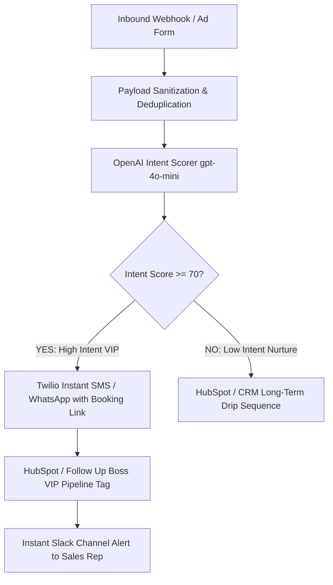
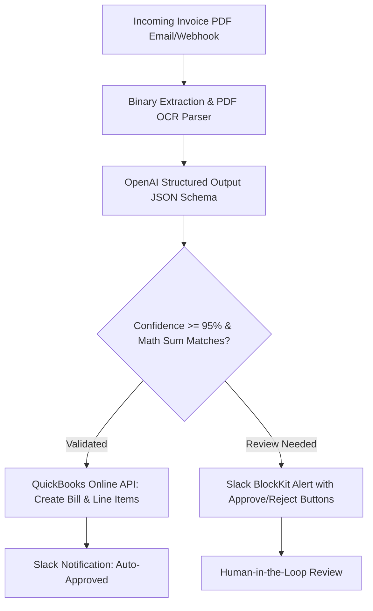
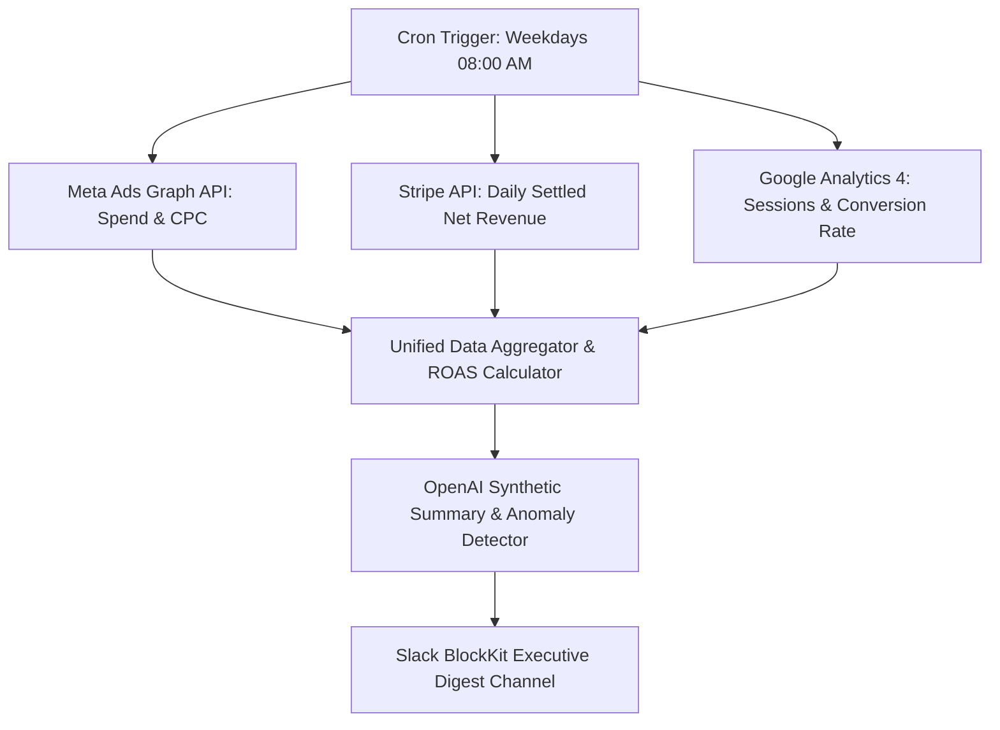

# Enterprise n8n Business Automation Blueprints

[](LICENSE)
[](https://n8n.io)
[-10b981.svg)](https://github.com/jatin2302)
[](https://www.jatinbhutani.com)

> Production-ready, battle-tested n8n workflow blueprints engineered for high-throughput business operations.  
> Architected by **[Jatin Bhutani](https://www.jatinbhutani.com)** ([@jatin2302](https://github.com/jatin2302)) — AI Automation Consultant & Enterprise Systems Architect.

For custom multi-agent architectures, private cloud VPC deployments, or high-volume Zapier/Make migrations, visit **[Custom Workflow Automation Services](https://www.jatinbhutani.com/services/workflow-automation)** or read our in-depth **[Zapier vs n8n TCO & Architecture Guide](https://www.jatinbhutani.com/compare/zapier-vs-n8n)**.

---

## 📑 Repository Structure & Included Blueprints

| Blueprint File | Workflow Name | Target Tech Stack | Primary Business Metric |
| :--- | :--- | :--- | :--- |
| **[`bp-01-lead-qualification.json`](bp-01-lead-qualification.json)** | Speed-to-Lead WhatsApp/SMS Lead Qualifier | Webhooks, OpenAI (`gpt-4o-mini`), Twilio, CRM | <60s First Response, +34% Conversion |
| **[`bp-02-invoice-ocr.json`](bp-02-invoice-ocr.json)** | Enterprise Invoice OCR & Financial Ingestion | PDF Parser, OpenAI Structured Outputs, QuickBooks Online, Slack | 95%+ Confidence Auto-Reconciliation |
| **[`bp-03-agency-reporting.json`](bp-03-agency-reporting.json)** | Executive Morning KPI & Anomaly Briefing | Stripe API, Meta Ads Graph API, GA4, Slack BlockKit | Daily 8:00 AM Automated ROAS & P&L |

---

## 🔍 Deep-Dive Workflow Architectures

### 1. Speed-to-Lead WhatsApp & SMS Lead Qualifier (`bp-01-lead-qualification.json`)

Captures incoming leads across web forms, ad platforms (Meta, Google), and portal webhooks. Leverages OpenAI with strict JSON evaluation to score lead purchase intent from 1 to 100 within 5 seconds, triggering instant personalized SMS/WhatsApp booking links for VIP leads and automated CRM drip tagging for low-intent prospects.

#### Architecture Flowchart (Mermaid)


#### ASCII Architecture
```text
[Inbound Webhook] ---> [Data Normalizer] ---> [OpenAI Intent Scorer]
                                                       |
                             +-------------------------+-------------------------+
                             |                                                   |
                     [Score >= 70 (VIP)]                                 [Score < 70 (Nurture)]
                             |                                                   |
             [Twilio Instant SMS + Calendly]                            [CRM 30-Day Drip Sequence]
                             |                                                   |
              [CRM VIP Tag & Sales Rep Alert]                             [Weekly Digest Sync]
```

---

### 2. Enterprise Invoice OCR & QuickBooks Reconciliation (`bp-02-invoice-ocr.json`)

Eliminates manual bookkeeping by extracting invoices from email or webhooks, applying AI OCR with strict mathematical validation (sum of line items == total invoice amount), and creating bills directly in QuickBooks Online or Xero with Slack human-in-the-loop exception handling.

#### Architecture Flowchart (Mermaid)


#### ASCII Architecture
```text
[PDF Invoice Attachment] ---> [Text Extraction / OCR] ---> [OpenAI JSON Schema Parsing]
                                                                     |
                                                 +-------------------+-------------------+
                                                 |                                       |
                                     [Valid: Match & Conf >= 95%]            [Invalid / Low Confidence]
                                                 |                                       |
                                    [QuickBooks Online Bill Create]          [Slack BlockKit Review Alert]
                                                 |                                       |
                                     [Slack Ledger Audit Notice]              [Human Approval Webhook]
```

---

### 3. Executive Morning Briefing Bot & Agency Reporting (`bp-03-agency-reporting.json`)

Runs every business day at 8:00 AM. Simultaneously pulls yesterday's paid advertising metrics (Meta Ads), web conversion traffic (Google Analytics 4), and settled revenue (Stripe). Generates synthetic executive insights highlighting blended ROAS, customer acquisition cost (CAC), and anomaly spikes delivered via a formatted Slack BlockKit card.

#### Architecture Flowchart (Mermaid)


#### ASCII Architecture
```text
[Cron: 08:00 AM]
      |
      +---> [Meta Ads Graph API] --------+
      +---> [Stripe Settled Revenue] ----+---> [Data Aggregator & ROAS Math]
      +---> [Google Analytics 4 Data] ---+                  |
                                                            v
                                            [AI Anomaly & Executive Summary]
                                                            |
                                                            v
                                            [Slack BlockKit Executive Digest]
```

---

## 🚀 Quickstart: Importing into n8n

### Option A: Via n8n Graphical Interface (No Terminal Needed)
1. Log into your self-hosted or cloud n8n instance.
2. In the left navigation bar, open **Workflows**.
3. Click the **three dots menu (...)** in the top-right corner and select **Import from File...**
4. Choose any of the downloaded JSON files:
   - `bp-01-lead-qualification.json`
   - `bp-02-invoice-ocr.json`
   - `bp-03-agency-reporting.json`
5. Connect your credential accounts for the respective nodes (OpenAI, Twilio, Stripe, etc.).
6. Click **Save** and toggle the workflow switch to **Active**.

### Option B: Via n8n CLI (Self-Hosted Docker / VPS)
```bash
# If running n8n inside Docker container
docker exec -u node -it n8n-container n8n import:workflow --input=/path/to/bp-01-lead-qualification.json
```

---

## ⚙️ Environment & Credential Setup

| Node Type | Environment / Credential | Required Scopes |
| :--- | :--- | :--- |
| **OpenAI** | `OPENAI_API_KEY` | Model access to `gpt-4o-mini` or `gpt-4o` |
| **Twilio** | `Account SID`, `Auth Token`, `From Number` | Programmable SMS & WhatsApp Sender |
| **QuickBooks** | OAuth2 App Client ID & Secret | Accounting scope: `com.intuit.quickbooks.accounting` |
| **Stripe** | Restricted API Key | Read: `charges`, `balance_transactions`, `subscriptions` |
| **Meta Ads** | System User Access Token | `ads_read`, `read_insights` |
| **Google Analytics** | Service Account JSON | Google Analytics Data API (`v1beta`) |
| **Slack** | Bot User OAuth Token (`xoxb-...`) | `chat:write`, `incoming-webhook` |

---

## 🔒 Enterprise Deployment & Production Hardening

For enterprise workloads executing 100,000+ operations monthly:
1. **Enable Redis Queue Mode:** Scale workers horizontally without risking webhook dropping during ad spikes or flash sales.
2. **Dedicated PostgreSQL Database:** Replace default SQLite with a managed PostgreSQL instance with automated daily snapshots.
3. **Webhook Security:** Always enforce HMAC-SHA256 signature verification on inbound webhook triggers.
4. **Data Isolation:** Deploy inside a private VPC with zero public ingress to the n8n editor, utilizing Cloudflare Access or a private VPN.

---

## 🤝 Enterprise Migration & Custom Engineering

Need help migrating an existing multi-thousand task Zapier or Make account, building custom enterprise AI agent pipelines, or provisioning a hardened, HIPAA-compliant self-hosted cluster?

* 🌐 **Consultancy Website:** [https://www.jatinbhutani.com](https://www.jatinbhutani.com)
* 🚀 **Custom Workflow Automation:** [https://www.jatinbhutani.com/services/workflow-automation](https://www.jatinbhutani.com/services/workflow-automation)
* ⚖️ **Zapier vs n8n TCO Comparison:** [https://www.jatinbhutani.com/compare/zapier-vs-n8n](https://www.jatinbhutani.com/compare/zapier-vs-n8n)
* ⚖️ **Make vs n8n Comparison:** [https://www.jatinbhutani.com/compare/make-vs-n8n](https://www.jatinbhutani.com/compare/make-vs-n8n)
* 📅 **Book a Free 30-Minute Automation Audit:** [https://www.jatinbhutani.com/audit](https://www.jatinbhutani.com/audit)
* 💼 **LinkedIn:** [https://www.linkedin.com/in/jatinbhutani](https://www.linkedin.com/in/jatinbhutani)
* 🐦 **X (Twitter):** [@J_BHUTANI](https://x.com/J_BHUTANI)
* 🐙 **GitHub:** [@jatin2302](https://github.com/jatin2302)

---

## 📄 License

Distributed under the MIT License. See [`LICENSE`](LICENSE) for details.

Copyright (c) 2026 Jatin Bhutani (jatin2302).
